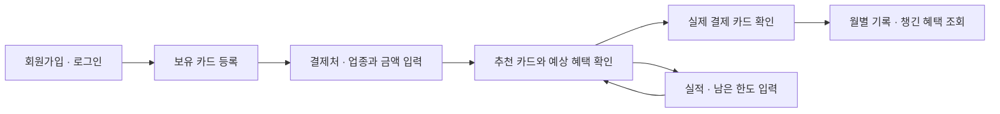

# Kattok Frontend


**결제하기 직전, 내 카드 중 가장 유리한 한 장을 찾아주는 서비스**

결제처와 금액을 입력하면 보유 카드의 혜택을 비교해
추천 카드와 예상 할인액, 추천 근거를 보여줍니다.

배포 링크:https://kattok.vercel.app/onboarding

## 주요 화면

| 홈 | 카드 추천 결과 | 내 카드 | 결제 기록 |
| :---: | :---: | :---: | :---: |
| 
 |  |  |  |
| 결제할 곳과 금액 입력 | 카드별 예상 혜택 비교 | 보유 카드와 실적·한도 관리 | 월별 기록과 챙긴 혜택 확인 |

## 주요 기능

| 구분 | 설명 |
| --- | --- |
| 회원가입·로그인 | 이메일 기반 회원가입·로그인, 자동 로그인 및 세션 만료 처리 |
| 카드 등록 | 카드사 선택, 카드 상품 검색, 지난달 실적 구간 선택 및 카드 등록 |
| 내 카드 관리 | 보유 카드 조회, 실적·남은 혜택 한도 수정 및 카드 삭제 |
| 카드 추천 | 결제처 또는 업종과 결제 금액을 기준으로 카드별 예상 혜택 비교 및 추천 |
| 결제 확인·기록 | 실제 결제 카드 확인, 월별 결제 기록 조회·수정 및 미결제 상태 전환 |
| 마이페이지 | 월별·카드별 챙긴 혜택 조회, 계산 방식 안내, 계정 정보·약관 확인 및 회원 탈퇴 |

## 서비스 이용 흐름



| 화면 | 사용자가 확인하는 내용 |
| --- | --- |
| 온보딩 | 계정 생성, 카드사·상품 선택, 실적 입력 |
| 홈·검색 | 이번 달 챙긴 혜택, 결제 확인 대기, 결제할 곳과 금액 입력 |
| 추천 결과 | 카드별 예상 혜택, 계산 근거, 조건부 안내와 추가 입력 |
| 내 카드 | 카드별 혜택과 실적·한도 상태 |
| 마이페이지 | 월별 결제 기록, 카드별 혜택 합계, 계정과 정책 |

## 기술 스택

| 구분 | 기술 | 버전 | 용도 |
| --- | --- | --- | --- |
| 언어 | JavaScript · JSX | — | 화면 및 기능 구현 |
| UI | React | 19 | 컴포넌트 기반 화면 구성 및 상태 관리 |
| 라우팅 | React Router | 7 | 페이지 이동 및 인증이 필요한 경로 관리 |
| 서버 상태 | TanStack Query | 5 | 서버 데이터 조회, 로딩·오류 상태 및 캐시 관리 |
| HTTP 통신 | Axios | 1 | API 요청과 인증 토큰·공통 오류 처리 |
| 스타일링 | Tailwind CSS | 4 | 모바일 중심 UI 및 상태별 스타일 구성 |
| 스타일 유틸리티 | clsx · tailwind-merge | 2 · 3 | 조건부 클래스 적용 및 Tailwind 클래스 충돌 정리 |
| 아이콘 | Lucide React | 1 | 아이콘 컴포넌트 사용 |
| 개발·빌드 | Vite | 8 | 개발 서버 실행 및 프로덕션 빌드 |
| 코드 품질 | ESLint · Prettier | 10 · 3 | 코드 검사 및 포맷 통일 |


## 시작하기

Node.js `20.19` 이상 또는 `22.12` 이상이 필요합니다.

```bash
git clone https://github.com/2026-line4-kattok/kattok-frontend.git
cd kattok-frontend
npm install
cp .env.example .env
npm run dev
```

### 환경 변수

| 이름                | 설명                                                                                                        |
| ------------------- | ----------------------------------------------------------------------------------------------------------- |
| `VITE_API_BASE_URL` | API 서버 주소입니다. 비워 두면 `/api`로 요청하며, 개발 서버에서는 `http://localhost:8080`으로 프록시됩니다. |

`.env` 파일은 Git에 올리지 않습니다. 환경 변수가 추가되면 `.env.example`도 함께 수정해 주세요.

### 스크립트

| 명령어            | 설명                 |
| ----------------- | -------------------- |
| `npm run dev`     | 개발 서버 실행       |
| `npm run build`   | 프로덕션 빌드        |
| `npm run preview` | 빌드 결과 미리보기   |
| `npm run lint`    | ESLint 검사          |
| `npm run format`  | Prettier 포맷팅 적용 |


### 구현 포인트

| 구현 항목 | 적용 방식 |
| --- | --- |
| 인증 만료 공통 처리 | 인증 요청에서 401을 받으면 토큰과 Query 캐시를 정리하고 로그인 안내로 이동합니다. 로그인 요청 자체의 401은 자격 증명 오류로 처리합니다. |
| 이전 세션 응답 구분 | 요청에 사용한 토큰과 현재 토큰을 비교하여, 이전 세션의 늦은 401 응답이 새 로그인 상태를 지우지 않도록 처리합니다. |
| 서버 상태 갱신 | 결제 결과와 카드 상태를 변경한 후 관련 Query를 갱신하여 기록·혜택 합계·카드 상태를 다시 조회합니다. |
| 카드 유형별 등록 | 상품 상세의 실적 유형에 따라 실적 선택 단계를 분기하고, 실적 입력이 필요한 상품에는 선택한 상태와 구간 ID를 전달합니다. |
| 카드 이미지 연결 | 상품 정보와 로컬 이미지 파일을 연결하는 유틸리티를 사용하며, 온보딩에서 카드 방향을 보정합니다. |
| 월별 기록 표시 | 한국 시간 기준의 월을 사용해 기록을 조회하고, 과거 기록의 스냅샷 이름을 현재 상품명으로 덮어쓰지 않습니다. |
| 화면 전환 | 로그인·회원가입 결과 화면의 디졸브와 뒤로 가기 전환을 온보딩·마이페이지에서 처리합니다. |

## API 연동

요청은 [공통 Axios 인스턴스](src/api/axiosInstance.js)를 사용합니다. `VITE_API_BASE_URL`을 기본 주소로 사용하고, 저장된 토큰을 `Authorization: Bearer <accessToken>`으로 전달합니다. 응답 인터셉터가 `res.data`를 반환하므로 호출부에서는 응답 본문을 바로 사용합니다.

| 영역 | 연동 API 예시 |
| --- | --- |
| 인증 | `POST /api/v1/auth/signup`, `POST /api/v1/auth/login` |
| 카드 등록 | `GET /api/v1/card-issuers`, `GET /api/v1/card-products`, `POST /api/v1/owned-cards` |
| 카드 관리 | `GET /api/v1/owned-cards`, `PUT /api/v1/owned-cards/{id}/state` |
| 홈·검색 | `GET /api/v1/home`, `GET /api/v1/merchants`, `GET /api/v1/merchant-categories` |
| 추천·결제 확인 | `POST /api/v1/recommendations`, `PUT /api/v1/recommendations/{id}/payment` |
| 기록·계정 | `GET /api/v1/payment-records`, `GET /api/v1/users/me`, `DELETE /api/v1/users/me` |

요청·응답 필드와 정책의 상세 계약은 팀에서 공유한 백엔드 API 명세와 Swagger UI를 기준으로 확인합니다. Swagger 제공 서버의 `/swagger-ui/index.html`에서 확인할 수 있습니다.


## 폴더 구조

```text
├── public/                정적 파일
├── src/
│   ├── api/               Axios 인스턴스 및 API 요청 함수
│   ├── assets/            이미지 등 리소스
│   ├── components/
│   │   ├── common/        공통 컴포넌트
│   │   └── layout/        레이아웃 컴포넌트
│   ├── hooks/             커스텀 훅
│   ├── pages/             페이지 컴포넌트 (페이지별 폴더)
│   ├── router/            라우트 설정
│   ├── stores/            Zustand 스토어
│   ├── utils/             유틸 함수
│   ├── App.jsx            RouterProvider 연결
│   ├── index.css          Tailwind CSS 진입점
│   └── main.jsx           앱 진입점, QueryClientProvider 연결
├── .env.example           환경 변수 예시
├── .prettierrc            Prettier 설정
├── eslint.config.js       ESLint 설정
├── jsconfig.json          에디터 경로 별칭 설정
└── vite.config.js         Vite 설정, 경로 별칭 및 API 프록시
```

## 개발 참고

- `src` 하위 파일은 `@/` 경로로 불러옵니다. 예: `import HomePage from '@/pages/Home/HomePage'`
- 새 페이지는 `src/pages/페이지명/페이지명Page.jsx`로 만들고 `src/router/router.jsx`에 등록합니다.
- API 요청은 `src/api/axiosInstance.js`의 `api`를 사용합니다. 응답 인터셉터가 `res.data`를 반환하므로 `.data` 없이 바로 값을 사용합니다.
- 조건부 클래스나 외부에서 받은 클래스를 합칠 때는 `src/utils/cn.js`의 `cn`을 사용합니다.
- 커밋 전에 `npm run lint`와 `npm run format`을 실행해 주세요.

## GitHub 전략

### 기본

- origin: https://github.com/2026-line4-kattok/kattok-frontend.git
- 최종 브랜치: `main` (배포 브랜치)
- 개발 브랜치: `develop`
- 매번 작업 전 `develop`을 pull 받아 충돌을 방지합니다.

```bash
git remote add origin https://github.com/2026-line4-kattok/kattok-frontend.git
```

### 이슈 전략

작업 시작 전에 Issue를 생성합니다.

- Assignees에 본인을 지정합니다.
- Issue 템플릿에 맞게 작성합니다.

### 브랜치 전략

작업 시작 전 기본 루틴은 다음과 같습니다.

```bash
git checkout develop
git pull origin develop
```

브랜치 형식은 다음과 같습니다. Issue 번호를 포함하고, 기능명은 영어 소문자로 작성합니다.

```text
타입/#이슈번호-기능명

ex) feat/#123-main-page
```

| 타입       | 설명          |
| ---------- | ------------- |
| `feat`     | 새로운 기능   |
| `fix`      | 버그 수정     |
| `style`    | CSS / UI 수정 |
| `refactor` | 코드 리팩토링 |
| `docs`     | 문서 수정     |
| `test`     | 테스트        |
| `chore`    | 설정 및 기타  |

```bash
git checkout -b feat/#123-main-page
```

### 커밋 전략

타입은 브랜치 전략과 동일합니다.

```text
타입: 작업내용

ex) feat: 메인 페이지 프로필 구현
```

### 작업 후

```bash
git push origin feat/#123-main-page
```

PR 방향은 다음과 같습니다.

```text
base: develop
compare: feat/#123-main-page
```

- PR 템플릿에 맞게 작성합니다.
- Assignees에 본인을 등록합니다.
- Reviewer를 서로 등록하고, Approve 후 각자 머지합니다.
